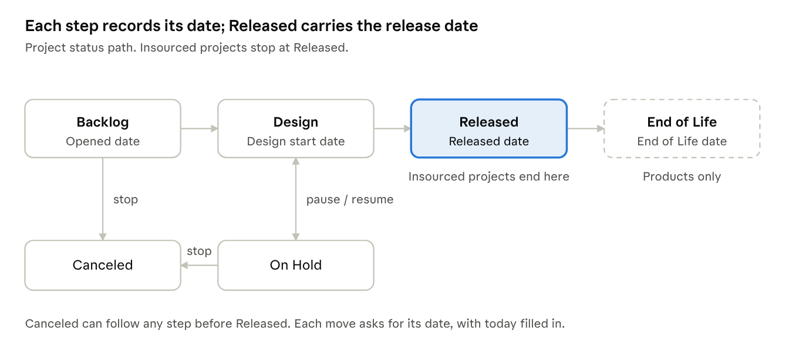
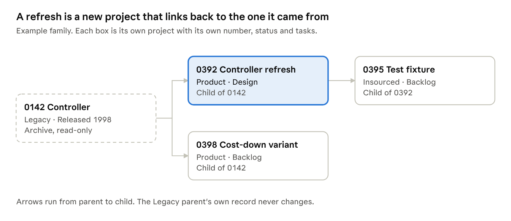
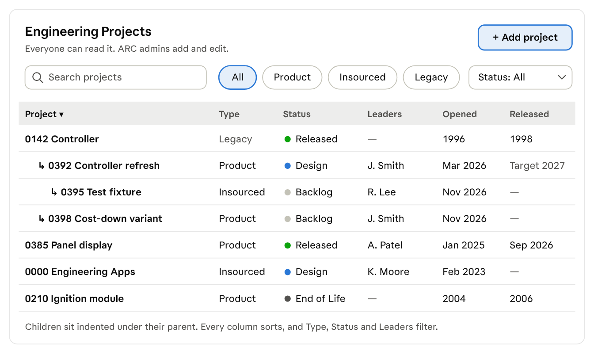
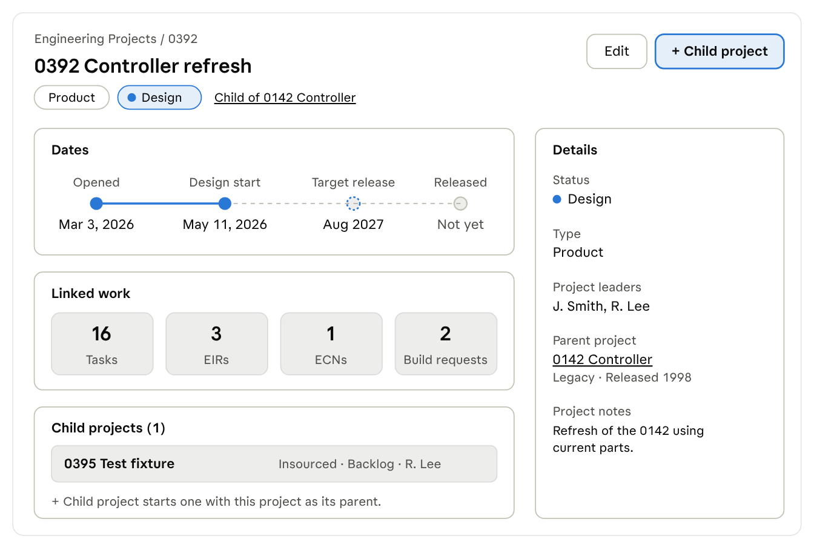
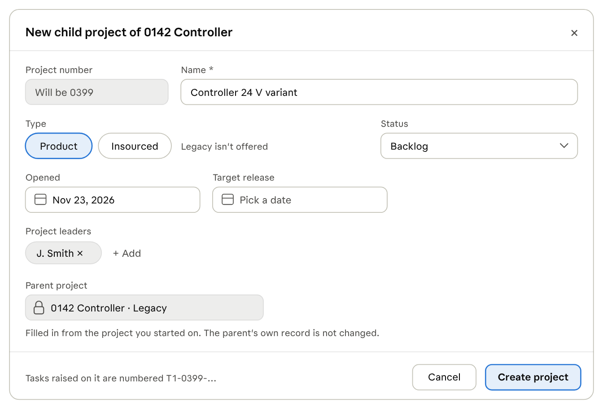

# Engineering Project Register — proposal

Nov 23, 2026 · Tim Webster · **Status: proposal, sent to Matt for review. Nothing built yet.**

A copy of the Claude Doc "Engineering Project Register — proposal"
(<https://claude.ai/artifact/3No4Bq6hZDqbY8snt6R7U3>). The doc stays the working copy; the
pictures here are screenshots of its drawings and mock-ups, in `engineering-project-register/`.

## Summary

Turn ARC's Projects list into an **Engineering Project Register** that anyone signed in can read. Each project gets a type, a status, its key dates and its leaders, and can have a parent project.

- **Types:** Product (a physical product), Insourced (an internal project) and Legacy (older projects, kept for reference).
- **Status and dates:** Backlog, Design, Released and End of Life, plus On Hold and Canceled. Each step records its date, so Valerie's release dates are on the list.
- **Parent and child projects:** for example, a refresh of a legacy product is a new project with its own number and a link back to the project it came from, much like parent and child tasks.
- **Where it lives:** the register moves out of Admin and into Engineering. Everyone can read it; ARC admins add and edit.
- **Data:** new columns on the existing Projects list, with a one-time fill from the old Project Log list. Task numbering and every project picker keep working unchanged.

It answers Altronic-LLC/BusinessIT#63 (ARC feature request #37, Valerie Sweeney): "a listing of engineering projects with release date like we had in SharePoint".

## Where things stand today

ARC already has the project list, but it holds only a number and a name, and the history with dates lives on a different list.

|  | Projects list (what ARC uses) | Project Log (the old register) |
| --- | --- | --- |
| Shown in SharePoint as | Project Status Overview | Project Log |
| Rows | 358 | 345, back to 1989 |
| Last change | 2026-10-13 (still in use) | 2026-07-22 |
| In ARC | Admin → Project References, admins only | Not read |
| Holds | Number and name (Title) | Number, name, Open and Closed dates, Owner, Status, Project Type, Notes |
| Read by | Task numbering, every project picker, EIRs, ECNs, build requests, the project delete check | Nothing |

- The Projects list looks abandoned because its built-in tracking columns (Progress, Priority, Start Date, Due Date, Project Leader) are empty on every row. The list itself is in daily use.
- The two lists match by number on 335 of 345 Project Log rows, and 324 of those also have the same name.
- The 10 newest projects (385 to 391, 2032, 2033 and 5016) are not on Project Log. Projects 232 and 248 are only on Project Log.
- Project Log's Owner is filled on 302 rows. Two projects have two owners.

## Project types

Every project is one of three types. The type is picked when the project is added and shows as a chip on every screen.

| Type | What it is | Example | New projects? | Reaches End of Life? |
| --- | --- | --- | --- | --- |
| Product | A physical product we design, release and sell | A new ignition module | Yes | Yes |
| Insourced | An internal project: a tool, fixture, process or bringing work in-house | 0000-Engineering Apps | Yes | No: it ends at Released |
| Legacy | An older project kept for reference, mostly from the Project Log fill | A 1990s controller | No, only by the fill or an admin | Kept as recorded |

- Project Log's own types map across: New becomes Product, Insourcing becomes Insourced, Legacy stays Legacy.
- A Legacy project is read-only for everyone except ARC admins. To pick it up again, start a child project (see below), so the archive record never changes.
- Projects with no type yet (the ten newest, and any not on Project Log) show **Not set** until an admin picks one.

## Status and dates

One status set covers every project, and each move records the date it happened. Released is the step Valerie asked for: it carries the release date.

| Status | Means | Records | Filled from Project Log |
| --- | --- | --- | --- |
| Backlog | Requested, not started | Opened date | Requested (86); Opened date comes from Open on every row |
| Design | Being designed or worked on | Design start date | Not recorded |
| Released | In production (Product) or finished (Insourced) | Released date | Complete (231) and Released (3); Closed date |
| End of Life | No longer sold or supported (Product only) | End of Life date | Not recorded |
| On Hold | Paused, may resume | Nothing extra | On Hold |
| Canceled | Stopped before release | Canceled date | Canceled (24); Closed date |

- A **Target release** date can be set at any time. It is a plan, not a record, and the register shows it until the real Released date exists.
- Changing status asks for that step's date, with today filled in, so a project released last spring can be recorded truthfully.
- Dates can be corrected later by an admin. Going back a step (Released to Design, say) keeps the earlier dates.

## Parent and child projects

A project can name one **parent project**. The child is a full project in its own right, with its own number, type, status, dates, leaders, tasks and EIRs. It also links back to its parent for reference, the way parent and child tasks work today.

- **Starting one:** a **New child project** button on the parent's page opens the new project form with the parent filled in and locked, as **New child task** does on a task. An admin can also set or change the parent later.
- **Any project can be a parent**, Legacy included. The child links back, and the parent's record is not touched.
- **Families can go more than one level deep** (a refresh of a refresh, a fixture for a refresh). ARC refuses a loop, such as a project made its own grandparent, as it already does for tasks.
- **The child's type starts as its parent's**, except that a Legacy parent's child starts as Product. It can be changed before saving.
- **The child takes the next free project number**, as any new project does. Tasks raised on the child are numbered under the child (T1-0392-…), so task numbering doesn't change.
- **Parents are not held open by their children**, unlike tasks. A legacy product can reach End of Life while its refresh is still in Design.

## Mock-up screens

Three screens carry the feature: the register, a project's page, and the form for a new child project. The data in them is made up, and colours follow the Claude Doc rather than ARC.

**1. The register** replaces Admin → Project References and sits in the Engineering menu and on the Dashboard. It shows every project, released ones included, since looking up a release date is the main reason to open it. The Status filter narrows it to work in progress.

**2. A project's page** builds on today's project view. It shows the dates along a line, counts of the tasks, EIRs, ECNs and build requests that name the project (each opens the filtered list), the parent as a link, and the children. Edit and Child project show only to ARC admins.

**3. New child project** is the ordinary new project form, opened from the parent's page with the parent filled in and locked. Add project on the register opens the same form with the parent left free to pick or leave blank.

## Who can do what

Everyone signed in can read the register; changes stay with ARC admins, as adding a project does today.

| Action | Anyone signed in | ARC admin |
| --- | --- | --- |
| See the register, open a project, filter and sort | Yes | Yes |
| Add a project or a child project | No | Yes |
| Change type, status, dates, leaders, parent | No | Yes |
| Edit a Legacy project | No | Yes |
| Delete a project (only once nothing points at it) | No | Yes |

- The Admin page keeps a link to the register, so admins find it where they always have.
- As everywhere in ARC, the real boundary is the SharePoint permission on the Projects list. Hiding the buttons only decides what people see.
- If project leaders should update their own project's status and dates, that's a small change: the people in Project Leaders could be allowed to edit that one project. See the questions below.

## SharePoint changes and the Project Log fill

The new fields are columns added to the existing Projects list, so ARC reads one list and nothing that uses projects today has to change.

| New column | Kind | Holds |
| --- | --- | --- |
| ProjectType | Choice | Product, Insourced, Legacy |
| ProjectStatus | Choice | Backlog, Design, Released, End of Life, On Hold, Canceled |
| OpenedDate | Date | When the project was opened |
| DesignStartDate | Date | When it entered Design |
| TargetReleaseDate | Date | The planned release |
| ReleasedDate | Date | The real release |
| EndOfLifeDate | Date | Product only |
| CanceledDate | Date | When it was stopped |
| ProjectLeaders | Person, several | Who leads it |
| ParentProject | Lookup to the same list | The parent project, if any |
| ProjectNotes | Text, several lines | Free notes |

- The empty built-in columns (Progress, Start Date, Due Date, Project Leader, Notes) are left alone and not reused. Their names don't match what they would hold, and Progress is set to Not started on every row.
- A script adds the columns, writes and reads back a test value on each, and must run before the release that shows them. ARC also keeps working if a column is missing: the register just shows that field as blank.

**The one-time fill from Project Log** matches rows by project number:

1. Project Type: New becomes Product, Insourcing becomes Insourced, Legacy stays Legacy.
2. Status: Requested becomes Backlog; Complete and Released become Released; On Hold and Canceled stay as they are.
3. Open becomes Opened date. Closed becomes Released date on released projects and Canceled date on canceled ones.
4. Owner becomes Project Leaders, the same people (both lists are on the Engineering site).
5. Notes become Project Notes.

The script writes only into empty fields, shows every planned change before it writes, and leaves Project Log untouched as the archive. The 11 matched rows whose names differ, and the rows on only one list, go in a report for someone to check by hand.

## Questions to settle before building

- [ ] **Statuses:** are Backlog, Design, Released, End of Life, On Hold and Canceled the right set? Does an Insourced project need a different word than Released (Complete, say)?
- [ ] **Project Log dates:** is Open the date the project was opened, and is Closed the release date?
- [ ] **Project Log status:** does Complete mean the product was released? It's 231 of the 345 rows.
- [ ] **Legacy:** which projects should be Legacy? Only those Project Log already calls Legacy, or also every project released before a cut-off year?
- [ ] **Child relationship:** is "parent project" enough, or should a child also say how it relates (Refresh, Variant, Sub-project)?
- [ ] **Who edits:** ARC admins only, or may a project's leaders update its status and dates?
- [ ] **Missing rows:** add 232 and 248 (only on Project Log) to the Projects list, or leave them in the archive?
- [ ] **More fields:** anything else Valerie or Matt want on the register, such as product family, SAP number or a link to the project folder?
